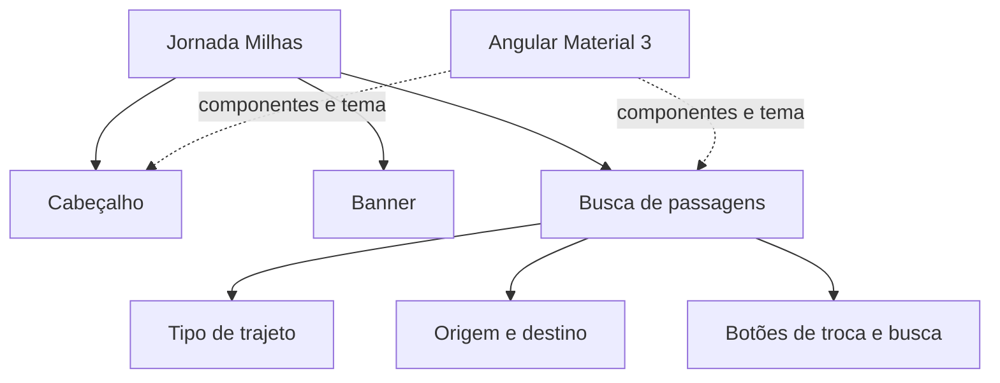

# Jornada Milhas

Aplicação de estudo desenvolvida para praticar a criação de interfaces com Angular e Angular Material. O projeto apresenta uma página de viagens com cabeçalho, banner e formulário visual de busca de passagens.

> **Escopo atual:** este é um protótipo didático de interface. A busca de passagens, a troca entre origem e destino e os links de navegação ainda não executam operações de negócio nem se conectam a uma API.

## Visão geral



### Stack utilizada

| Camada | Tecnologia | Uso no projeto |
| --- | --- | --- |
| Framework | Angular 22 | Aplicação e componentes standalone. |
| Componentes visuais | Angular Material 22 | Botões, campos, ícones, tooltip e seleção do trajeto. |
| Utilitários de interface | Angular CDK 22 | Base de infraestrutura para os componentes Material. |
| Linguagem | TypeScript 6 | Código dos componentes Angular. |
| Estilos | SCSS | Estilos globais, estilos de componentes e tema Material 3. |
| Reatividade | RxJS 7 | Dependência utilizada pelo ecossistema Angular; não há fluxos de dados de negócio implementados ainda. |
| Gerenciador de pacotes | npm | Instalação de dependências e execução de scripts. |
| Testes | Vitest 5 e Angular CLI | Ferramentas de teste configuradas no projeto. |

## Pré-requisitos

- Node.js e npm instalados.

## Como executar

No terminal, entre na pasta do projeto e instale as dependências:

```bash
cd jornada-milhas
npm install
```

Inicie o servidor de desenvolvimento:

```bash
npm start
```

Abra no navegador o endereço informado pelo Angular CLI (normalmente `http://localhost:4200/`). O servidor atualiza a aplicação quando os arquivos são alterados.

## Comandos disponíveis

| Comando | Descrição |
| --- | --- |
| `npm start` | Inicia o servidor de desenvolvimento (`ng serve`). |
| `npm run build` | Compila a aplicação para produção. |
| `npm run watch` | Recompila continuamente usando a configuração de desenvolvimento. |
| `npm test` | Executa os testes configurados pelo Angular CLI. |
| `npm run ng -- <comando>` | Executa um comando do Angular CLI, por exemplo `npm run ng -- generate component exemplo`. |

## O que a interface demonstra

- **Cabeçalho:** marca, links de navegação e botões de cadastro e login.
- **Banner:** imagem de destaque da página.
- **Busca de passagens:** seleção visual entre ida e volta ou somente ida, campos de origem e destino, ícones, botão para trocar os locais e botão Buscar.
- **Angular Material:** botões, grupo de botões de alternância, campos de formulário, ícones e tooltip.
- **Tema Material 3:** paletas de cores e variáveis de tema aplicadas globalmente.

Os controles mostram os componentes e estilos, mas ainda não estão ligados a uma lógica de busca ou autenticação.

## Como utilizar o sistema

1. Inicie o projeto com `npm start` e abra no navegador o endereço local mostrado no terminal.
2. No cabeçalho, observe a marca, os links e os botões de cadastro e login. Eles são elementos demonstrativos e não navegam para páginas funcionais.
3. Na seção **Passagens**, selecione **Ida e volta** ou **Somente ida** para experimentar o grupo de botões.
4. Digite texto nos campos **Origem** e **Destino** para testar os campos do Material.
5. Use o ícone de troca para ver a dica de ferramenta. O botão ainda não altera os valores dos campos.
6. O botão **Buscar** representa a ação principal visualmente; no estado atual, ele não executa uma pesquisa nem apresenta resultados.

Esta demonstração não requer cadastro, não salva dados e não consulta serviços externos. Para transformar o protótipo em um sistema funcional, será necessário implementar a lógica dos controles, validação dos campos, navegação e integração com uma API.

## Estrutura do projeto

```text
src/
├── app/
│   ├── banner/                  # Banner de destaque
│   ├── form-busca-passagens/    # Formulário de busca
│   ├── header/                  # Cabeçalho e navegação
│   ├── app.html                 # Composição da página
│   ├── app.scss                 # Estilos da aplicação
│   └── theme-colors.scss        # Paletas do tema Angular Material
├── index.html                   # Documento HTML principal
├── reset.scss                   # Normalização de estilos
└── styles.scss                  # Tema e estilos globais

public/
└── images/                      # Logo e banner
```

Os componentes são standalone: cada componente importa os módulos Angular Material de que seu template precisa. Os estilos globais e a configuração do tema ficam em `src/styles.scss`; os estilos específicos ficam junto de cada componente.

## Personalização do tema

As paletas geradas pelo Angular Material estão em `src/app/theme-colors.scss`. O arquivo `src/styles.scss` carrega essas paletas e aplica o tema Material 3. Para gerar paletas a partir de uma nova cor, execute na raiz do projeto:

```bash
npm exec -- ng generate @angular/material:theme-color
```

Siga as instruções do Angular CLI e revise o arquivo gerado. Se você já tiver feito ajustes manuais nas paletas, salve-os antes de gerar novamente.

## Testes

Execute os testes com:

```bash
npm test
```

Os testes existentes são testes básicos de componentes. Ao adicionar funcionalidades, crie testes que cubram também o comportamento esperado da interface.
